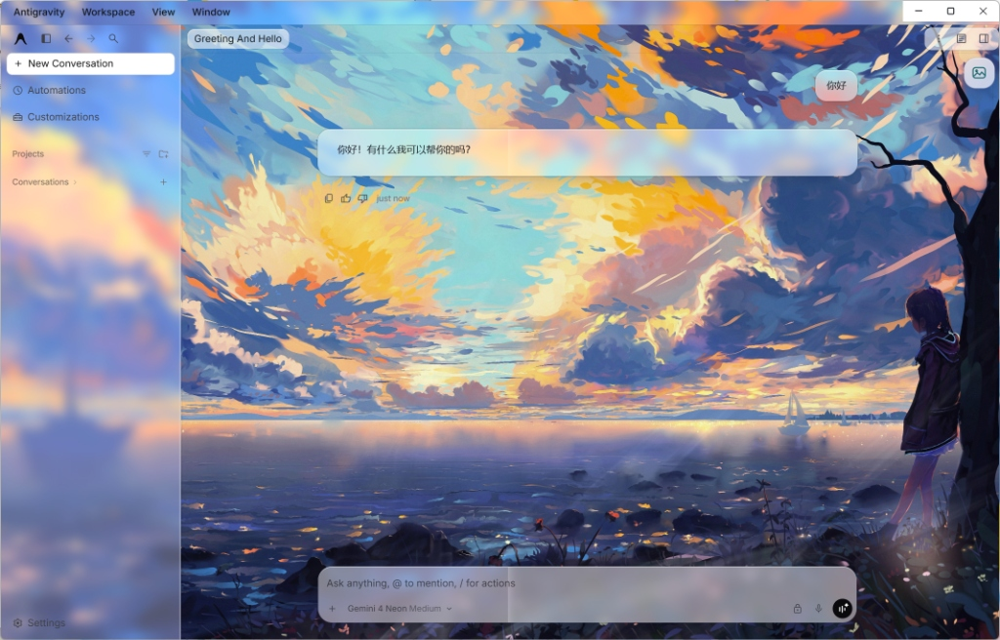
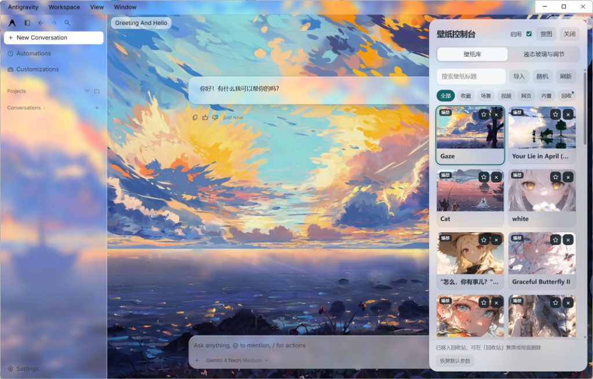
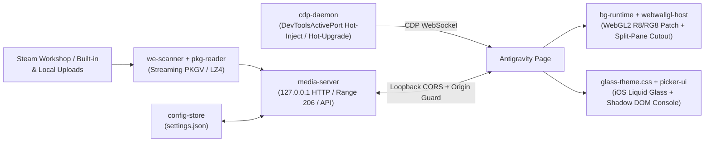

<div align="center">

# agy-wallpaper-engine

**Live Wallpapers & iOS Liquid Glass Theme for Google Antigravity Desktop**

Play your Steam Wallpaper Engine library or import local videos & images<br/>
Zero patching of Antigravity's install folder · Survives app updates · Silent autostart

[](https://github.com/moran-622/agy-wallpaper-engine/actions/workflows/ci.yml)
[](./LICENSE)
[](https://nodejs.org/)
[](#quick-start)
[](#cli-commands)

[简体中文](./README.md) · **English**

[Showcase](#showcase) · [Highlights](#highlights) · [Quick Start](#quick-start) · [Shortcuts & Presets](#shortcuts--presets) · [FAQ](#faq)

</div>

---

## Showcase

<div align="center">
  
  <br />
  <sub><b>Liquid Glass Main UI</b> — Real-time Steam Wallpaper Engine scene with floating translucent chat cards and frosted sidebar</sub>
</div>

<br />

<div align="center">
  
  <br />
  <sub><b>Wallpaper Console</b> — Single-row category chips, pinned favorites, live glass tuning & two-stage recycle bin</sub>
</div>

---

## Highlights

<table>
  <tr>
    <td width="50%" valign="top">
      <h3>🎬 Use Your Steam Wallpapers Instantly</h3>
      Automatically finds your Steam Wallpaper Engine Workshop & built-in library (live WebGL2 scenes, videos, web wallpapers, and images). <b>No Steam? No problem</b>—import local MP4 / WebM / GIF / images up to 200 MB.
    </td>
    <td width="50%" valign="top">
      <h3>🫧 iOS Liquid Glass Theme</h3>
      Includes <b>4 handcrafted presets</b> (Liquid Auto, Crystal, Frosted, Cinema Dark), independent light/dark/auto glass tones, and 7 live sliders to dial in the exact balance between clarity and legibility.
    </td>
  </tr>
  <tr>
    <td width="50%" valign="top">
      <h3>👁️ One-Key Pure Viewing Mode</h3>
      Press <code>Alt+Shift+H</code> to fade out the entire UI and enjoy your wallpaper unobstructed; press <code>Esc</code> to jump right back in. Drag the edge dock vertically or toggle the console anytime with <code>Alt+Shift+W</code>.
    </td>
    <td width="50%" valign="top">
      <h3>🧩 Built for Antigravity Layouts</h3>
      Embedded browser split panes stay crystal-clear with automatic cutouts and dock repositioning. Native dropdowns, Settings dialogs, and wide Markdown tables stay crisp and horizontally scrollable.
    </td>
  </tr>
  <tr>
    <td width="50%" valign="top">
      <h3>🗑️ Safe Two-Stage Recycle Bin</h3>
      Click <code>×</code> to tuck unwanted wallpapers into Trash first—restore one or all anytime, or purge after inline confirmation. <b>Never deletes or modifies your original Steam files.</b>
    </td>
    <td width="50%" valign="top">
      <h3>🛡️ Zero-Invasion & Update-Proof</h3>
      Never modifies Antigravity's install directory or <code>app.asar</code>. Everything lives cleanly in your user folder, paired with a standalone <code>Antigravity (CDP)</code> shortcut that survives app updates.
    </td>
  </tr>
</table>

---

## Quick Start

> **Requirements**: Windows 10 / 11 · [Node.js](https://nodejs.org/) `>= 22.13` · Google Antigravity Desktop (Steam Wallpaper Engine is optional)

### 1️⃣ Clone and install

```powershell
git clone https://github.com/moran-622/agy-wallpaper-engine.git
cd agy-wallpaper-engine
npm install
```

### 2️⃣ One-command setup

```powershell
node install.mjs install
```

No admin rights needed. This automatically:
- Creates a standalone **`Antigravity (CDP)`** shortcut in your Start Menu;
- Registers a silent, windowless Windows Startup launcher;
- Starts the loopback-only (`127.0.0.1`) background service.

### 3️⃣ Launch via `Antigravity (CDP)`

**Fully quit** any open Antigravity window (including the system tray), then open **`Antigravity (CDP)`** from the Start Menu (tip: pin it to your taskbar).

Click the floating wallpaper icon on the right edge—or press **`Alt+Shift+W`**—to open the Wallpaper Console!

> [!TIP]
> **Why use `Antigravity (CDP)`? What happens when Antigravity updates?**
> Antigravity's updater may overwrite the default shortcut, but it leaves your dedicated **`Antigravity (CDP)`** shortcut—and all your settings & uploads—untouched.
> After an update, simply quit Antigravity completely and reopen it from **`Antigravity (CDP)`**. If a major update changes the executable path, run `node install.mjs shortcut` once to refresh it.

---

## Shortcuts & Presets

### Keyboard Shortcuts

| Shortcut | Action |
| :--- | :--- |
| `Alt + Shift + W` | Toggle the Wallpaper Console |
| `Alt + Shift + H` | Toggle **Pure Viewing (Peek) mode** to hide the entire UI |
| `Esc` | Exit Peek mode → or cancel purge confirmation → or close the console |

### 4 Built-in Liquid Glass Presets

| Preset | Best For | Dim | Canvas Veil | Card Opacity | Sidebar Opacity | Glass Blur |
| :--- | :--- | :---: | :---: | :---: | :---: | :---: |
| **Liquid Auto** | Default balanced translucency & readability | `10%` | `0%` | `68%` | `44%` | `14px` |
| **Crystal** | Minimal veil & crisp highlights to showcase artwork | `4%` | `0%` | `48%` | `30%` | `8px` |
| **Frosted** | Higher frost & contrast for long reading or coding | `16%` | `12%` | `82%` | `56%` | `16px` |
| **Cinema Dark** | Deep dim & high-contrast dark glass for night use | `26%` | `6%` | `68%` | `50%` | `16px` |

---

## CLI Commands

| Command | Description |
| :--- | :--- |
| `node install.mjs install` | Full setup: register autostart, create `Antigravity (CDP)` shortcut & start daemon |
| `node install.mjs status` | Check daemon status, port, wallpaper count & active wallpaper |
| `node install.mjs start` | Start daemon with duplicate-instance protection (`--port` / `--wallpaper` optional) |
| `node install.mjs stop` | Stop daemon and immediately restore Antigravity's native UI |
| `node install.mjs shortcut` | Create or refresh the `Antigravity (CDP)` Start Menu shortcut |
| `node install.mjs uninstall` | Stop daemon and remove autostart (**keeps** your settings & uploads) |
| `npm test` | Run all 69 automated unit & integration tests |

---

## FAQ

<details>
<summary><b>1. The floating wallpaper icon didn't appear after launching Antigravity</b></summary>

1. Make sure Antigravity was **fully closed** (check the system tray), then open it via **`Antigravity (CDP)`**;
2. Run `node install.mjs status` and confirm `running: true` (otherwise run `node install.mjs start`);
3. If needed, run `node install.mjs shortcut` to refresh the shortcut and relaunch Antigravity.

</details>

<details>
<summary><b>2. Can I use this without Steam Wallpaper Engine, or with Steam on another drive?</b></summary>

- **Without Steam**: Yes! Click **Import** in the wallpaper console to upload local images, GIFs, MP4, or WebM videos (up to 200 MB per file).
- **Custom Steam drive**: Cross-drive `libraryfolders.vdf` libraries are detected automatically. To scan extra custom folders, add them to `customDirs` in `%USERPROFILE%\.gemini\antigravity\wallpaper-engine\settings.json` and click **Refresh**.

</details>

<details>
<summary><b>3. Why do a few Scene wallpapers fall back to an image or embedded video?</b></summary>

Most 2D scenes and particle systems render natively in WebGL2 via `webwallgl`, while a small number of Workshop scenes rely on native C++ shaders unsupported in browsers. If a scene does not emit its first frame within 8 seconds, it smoothly falls back to embedded video or the preview image instead of freezing.

</details>

<details>
<summary><b>4. Text feels hard to read over a very bright or very dark wallpaper</b></summary>

Open the Wallpaper Console → switch to **Liquid Glass & Controls**:
- For bright wallpapers, pick **Liquid Auto** or **Frosted** with **Light Glass**;
- For dark wallpapers, pick **Cinema Dark** with **Dark Glass**, and raise **Dim** or **Card Opacity** slightly.

</details>

<details>
<summary><b>5. Port 18765 is in use, or how do I fully uninstall?</b></summary>

- **Change port**: Run `node install.mjs start --port 18888`.
- **Uninstall**: Run `node install.mjs uninstall` to stop the service, restore Antigravity's native UI, and remove Windows autostart. Your settings & uploads are preserved; remove `%USERPROFILE%\.gemini\antigravity\wallpaper-engine\` and the Start Menu `Antigravity (CDP)` shortcut manually if you want a full wipe.

</details>

---

## Architecture & Storage Paths (For Developers)

<details>
<summary><b>Expand for architecture diagram, engineering notes & local storage paths</b></summary>

### Architecture



### Key Engineering Details
- **Streaming `PKGV` / LZ4 reader**: `src/pkg-reader.mjs` serves assets directly from `scene.pkg` / `.mpkg` with LRU caching and zero full-disk extraction.
- **WebGL2 `R8/RG8` particle albedo fix**: `src/webwallgl-host/renderer.js` tracks single/dual-channel texture formats and patches `u_albedoR8` shader sampling so particle sprites render cleanly.
- **In-place hot-upgrade**: `bg-runtime.js` and `picker-ui.js` hand off cleanly on version bump without restarting Antigravity.
- **Event-driven split-pane cutout**: `MutationObserver` + `ResizeObserver` compute `[data-browser-hole="true"]` rects into `clip-path: path(evenodd, ...)`.

### Storage Paths

| Path | Purpose |
| :--- | :--- |
| `%USERPROFILE%\.gemini\antigravity\wallpaper-engine\settings.json` | Theme preset, sliders, active wallpaper, favorites & trash state (atomic write with `.bak` corruption backup) |
| `%USERPROFILE%\.gemini\antigravity\wallpaper-engine\uploads\` | Locally uploaded wallpapers & metadata index |
| `%USERPROFILE%\.gemini\antigravity\wallpaper-engine\daemon.pid` / `daemon-meta.json` | Running daemon PID and loopback port metadata |
| `%APPDATA%\Antigravity\DevToolsActivePort` | Antigravity CDP port file (read-only watch) |
| `%APPDATA%\Microsoft\Windows\Start Menu\Programs\Antigravity (CDP).lnk` | Update-resilient CDP Start Menu shortcut |
| `%APPDATA%\Microsoft\Windows\Start Menu\Programs\Startup\AntigravityWallpaperDaemon.vbs` | Windowless Windows Startup launcher |

</details>

---

## Credits

- [**webwallgl**](https://github.com/oneincase/webwallgl) (MIT) — Browser-based WebGL2 renderer for Wallpaper Engine scenes.
- [**elysia395/dsh-wallpaper-engine**](https://github.com/elysia395/dsh-wallpaper-engine) (MIT) — Independent rewrite built from scratch for Google Antigravity Desktop (zero external plugin framework dependencies, no code copying), inspired by its product vision, `PKGV`/LZ4 archive parsing, and Steam library discovery conventions, with full MIT attribution preserved.

## License

Released under the [MIT License](./LICENSE).
