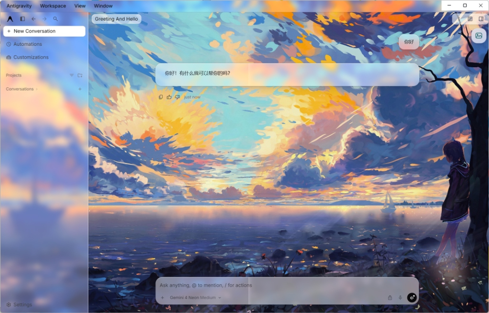
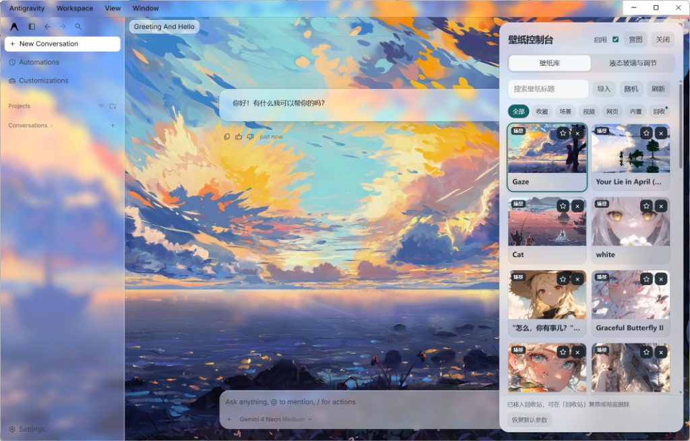
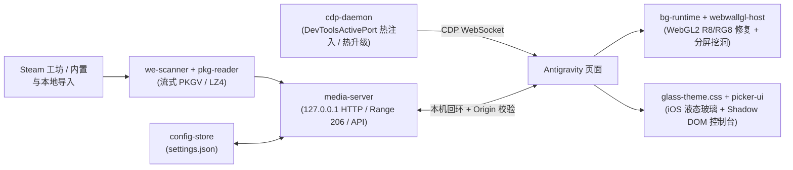

<div align="center">

# agy-wallpaper-engine

**给 Google Antigravity 换上动态壁纸与 iOS 液态玻璃主题**

直接调用你的 Steam Wallpaper Engine 创意工坊壁纸，也能导入本地视频 / 图片<br/>
不修改软件安装目录 · 更新无痛恢复 · 开机静默自启

[](https://github.com/moran-622/agy-wallpaper-engine/actions/workflows/ci.yml)
[](./LICENSE)
[](https://nodejs.org/)
[](#三步上手)
[](#常用命令)

**简体中文** · [English](./README.en.md)

[效果预览](#效果预览) · [核心亮点](#核心亮点) · [三步上手](#三步上手) · [快捷键与预设](#快捷键与预设) · [常见问题](#常见问题)

</div>

---

## 效果预览

<div align="center">
  
  <br />
  <sub><b>液态玻璃主界面</b> — Steam Wallpaper Engine 实时动态场景 + 通透悬浮对话卡片与磨砂侧栏</sub>
</div>

<br />

<div align="center">
  
  <br />
  <sub><b>右侧壁纸控制台</b> — 单行分类筛选、一键收藏置顶、实时调节玻璃质感与两段式回收站</sub>
</div>

---

## 核心亮点

<table>
  <tr>
    <td width="50%" valign="top">
      <h3>🎬 直接用你的 Steam 动态壁纸</h3>
      自动扫描本机 Steam Wallpaper Engine 创意工坊与内置壁纸，动画场景、视频、网页、图片全支持。<b>没装 Steam 也没关系</b>，可直接导入本地 MP4 / WebM / GIF / 图片（单文件最大 200 MB）。
    </td>
    <td width="50%" valign="top">
      <h3>🫧 iOS 液态玻璃质感</h3>
      内置 <b>4 套精调预设</b>（液态灵动 / 极致赏图 / 长文专注 / 暗夜影院），支持浅色、深色或跟随系统色调，7 项实时滑块随心调节磨砂、压暗与卡片透明度，兼顾颜值与文字清晰度。
    </td>
  </tr>
  <tr>
    <td width="50%" valign="top">
      <h3>👁️ 一键纯净赏图</h3>
      按下 <code>Alt+Shift+H</code> 一秒隐藏所有聊天界面，沉浸欣赏完整动态壁纸；按 <code>Esc</code> 瞬间回到对话。右侧悬浮图标支持上下拖拽并记忆位置，按 <code>Alt+Shift+W</code> 随时开关控制台。
    </td>
    <td width="50%" valign="top">
      <h3>🧩 贴心适配 Antigravity 布局</h3>
      打开右侧内嵌浏览器分屏时，壁纸会自动挖空避让、控制台自动挪到左侧不挡视野；顶部下拉菜单、设置弹窗和宽表格横向滚动都经过专门优化，清清楚楚不透底。
    </td>
  </tr>
  <tr>
    <td width="50%" valign="top">
      <h3>🗑️ 两段式回收站，绝不误删</h3>
      不想看到的壁纸点 <code>×</code> 先放进「回收」，随时单个或全部复原；二次确认后才彻底移除，且<b>绝不会删除或改动你的 Steam 原始壁纸文件</b>。
    </td>
    <td width="50%" valign="top">
      <h3>🛡️ 零侵入，软件更新不失效</h3>
      完全不修改 Antigravity 安装目录与核心文件，所有数据保存在你自己的用户目录里；自动生成独立的 <code>Antigravity (CDP)</code> 快捷方式，反重力更新后也能直接无痛恢复。
    </td>
  </tr>
</table>

---

## 三步上手

> **环境要求**：Windows 10 / 11 · [Node.js](https://nodejs.org/) `>= 22.13` · Google Antigravity Desktop（Steam Wallpaper Engine 为可选项）

### 1️⃣ 下载项目并安装依赖

```powershell
git clone https://github.com/moran-622/agy-wallpaper-engine.git
cd agy-wallpaper-engine
npm install
```

### 2️⃣ 一键配置自启与快捷方式

```powershell
node install.mjs install
```

这条命令无需管理员权限，会自动完成三件事：
- 在开始菜单生成独立的 **`Antigravity (CDP)`** 启动快捷方式；
- 注册无黑框的 Windows 开机静默自启；
- 启动纯本机后台服务（仅监听 `127.0.0.1`，不联网、不上传任何数据）。

### 3️⃣ 用 `Antigravity (CDP)` 启动

**先彻底退出**正在运行的 Antigravity（包括右下角托盘），然后在开始菜单搜索并打开 **`Antigravity (CDP)`**（建议右键固定到任务栏）。

打开后，界面右侧边缘会出现一个小壁纸图标——点击它或直接按 **`Alt+Shift+W`**，就能开始挑壁纸、调玻璃效果了！

> [!TIP]
> **为什么以后都用 `Antigravity (CDP)` 打开？更新后怎么办？**
> Antigravity 官方更新时可能会重置默认的桌面/开始菜单快捷方式，但不会碰独立的 **`Antigravity (CDP)`**，也不会影响你的壁纸配置和导入文件。
> 如果某次 Antigravity 更新后壁纸暂时没出现：**彻底退出 Antigravity → 从 `Antigravity (CDP)` 重新打开**即可恢复；极少数大版本变更了主程序路径时，重新运行一次 `node install.mjs shortcut` 刷新快捷方式即可。

---

## 快捷键与预设

### 常用快捷键

| 快捷键 | 作用 |
| :--- | :--- |
| `Alt + Shift + W` | 打开 / 收起壁纸控制台 |
| `Alt + Shift + H` | 开启 / 退出 **纯净赏图模式**（隐藏全部界面看壁纸） |
| `Esc` | 退出纯净赏图 → 或取消删除确认 → 或关闭控制台 |

### 4 套内置液态玻璃预设

| 预设 | 适合场景 | 压暗 | 画布薄纱 | 卡片底板 | 侧栏底板 | 玻璃磨砂 |
| :--- | :--- | :---: | :---: | :---: | :---: | :---: |
| **液态灵动** | 默认推荐，通透观感与阅读清晰度最均衡 | `10%` | `0%` | `68%` | `44%` | `14px` |
| **极致赏图** | 画面最清透、遮挡最少，适合欣赏精美壁纸 | `4%` | `0%` | `48%` | `30%` | `8px` |
| **长文专注** | 更厚实的磨砂底板，长时间看文档/写代码更护眼 | `16%` | `12%` | `82%` | `56%` | `16px` |
| **暗夜影院** | 深色压暗与高对比浅色文字，夜间使用舒适不刺眼 | `26%` | `6%` | `68%` | `50%` | `16px` |

---

## 常用命令

| 命令 | 说明 |
| :--- | :--- |
| `node install.mjs install` | 一键安装（注册开机自启 + 创建 CDP 快捷方式 + 启动服务） |
| `node install.mjs status` | 查看运行状态、监听端口、扫描到的壁纸数与当前壁纸 |
| `node install.mjs start` | 手动启动后台服务（自动防重复启动，可选 `--port` / `--wallpaper`） |
| `node install.mjs stop` | 停止服务并立即还原 Antigravity 原生界面 |
| `node install.mjs shortcut` | 单独重新生成或修复 `Antigravity (CDP)` 快捷方式 |
| `node install.mjs uninstall` | 停止服务并取消开机自启（**保留**你的配置和已导入的壁纸） |
| `npm test` | 运行全部 64 项自动化测试 |

---

## 常见问题

<details>
<summary><b>1. 打开 Antigravity 后，右侧没有出现壁纸图标怎么办？</b></summary>

1. 确认已**彻底退出**旧的 Antigravity（检查右下角系统托盘），再通过开始菜单的 **`Antigravity (CDP)`** 启动；
2. 在项目目录运行 `node install.mjs status`，确认输出中 `running` 为 `true`（如果是 `false`，执行 `node install.mjs start`）；
3. 若仍未生效，执行一次 `node install.mjs shortcut` 重新生成快捷方式后重启 Antigravity。

</details>

<details>
<summary><b>2. 没买 Steam Wallpaper Engine，或者 Steam 装在其他盘能用吗？</b></summary>

- **没装 Steam**：完全可以用！打开壁纸控制台点右上角 **「导入」**，就能添加本地图片、GIF、MP4、WebM 动态壁纸（单文件最高 200 MB）。
- **Steam 在其他盘**：程序会自动读取 Steam 跨盘库配置，无需手动填路径；如果你想额外扫描某个自建壁纸文件夹，只需把路径加到 `%USERPROFILE%\.gemini\antigravity\wallpaper-engine\settings.json` 的 `customDirs` 列表里再点「刷新」。

</details>

<details>
<summary><b>3. 为什么个别 Steam 场景壁纸显示成了静态图或内嵌视频？</b></summary>

绝大多数 2D 动态场景与粒子特效都能在浏览器 WebGL2 引擎中流畅运行，但极少数依赖原生 C++ 特效的复杂创意工坊壁纸无法直接在网页环境渲染。遇到这类壁纸时，程序会在 8 秒后自动平滑切换为内嵌视频或高清预览图，不会白屏或卡死。

</details>

<details>
<summary><b>4. 壁纸太亮或太暗，导致聊天文字不太好辨认？</b></summary>

打开壁纸控制台 → 切到 **「液态玻璃与调节」**：
- 亮色壁纸推荐 **液态灵动** / **长文专注** + **浅色玻璃**；
- 暗色壁纸推荐 **暗夜影院** + **深色玻璃**，也可以把「壁纸压暗」或「消息与输入框底板」滑块稍微往右拉一点。

</details>

<details>
<summary><b>5. 默认端口 18765 被占用，或者想彻底卸载？</b></summary>

- **换端口**：运行 `node install.mjs start --port 18888` 即可指定新端口；
- **卸载**：运行 `node install.mjs uninstall` 会立刻停止服务、还原原生界面并移除开机自启。你的配置和导入壁纸默认保留；如需全部清空，手动删掉 `%USERPROFILE%\.gemini\antigravity\wallpaper-engine\` 和开始菜单里的 `Antigravity (CDP)` 快捷方式即可。

</details>

---

## 技术架构与数据路径（给开发者）

<details>
<summary><b>展开查看：工作原理图、目录结构、技术细节与本地文件存储位置</b></summary>

### 工作原理



### 核心工程细节
- **流式 `PKGV` / LZ4 解包**：`src/pkg-reader.mjs` 按需从 `scene.pkg` / `.mpkg` 读取资源并做 LRU 缓存，零全盘解包。
- **WebGL2 `R8/RG8` 粒子通道修复**：`src/webwallgl-host/renderer.js` 拦截单/双通道粒子纹理并修正 `u_albedoR8` 着色器采样，避免粒子贴图发黑成方块。
- **脚本原地热升级**：`bg-runtime.js` 与 `picker-ui.js` 带版本号检测，升级代码重启守护进程即可无缝接管，无需重启 Antigravity。
- **零轮询分屏挖洞**：通过 `MutationObserver` + `ResizeObserver` 计算 `[data-browser-hole="true"]` 区域并生成 `clip-path: path(evenodd, ...)` 挖空。

### 数据存储路径

| 路径 | 用途 |
| :--- | :--- |
| `%USERPROFILE%\.gemini\antigravity\wallpaper-engine\settings.json` | 预设、滑块参数、当前壁纸、收藏与回收站记录（原子写入，损坏自动 `.bak` 备份） |
| `%USERPROFILE%\.gemini\antigravity\wallpaper-engine\uploads\` | 本地导入壁纸文件与索引 |
| `%USERPROFILE%\.gemini\antigravity\wallpaper-engine\daemon.pid` / `daemon-meta.json` | 后台进程 PID 与端口元数据 |
| `%APPDATA%\Antigravity\DevToolsActivePort` | Antigravity 本地调试端口文件（只读监听） |
| `%APPDATA%\Microsoft\Windows\Start Menu\Programs\Antigravity (CDP).lnk` | 独立的防更新覆盖启动快捷方式 |
| `%APPDATA%\Microsoft\Windows\Start Menu\Programs\Startup\AntigravityWallpaperDaemon.vbs` | 无黑框静默开机自启脚本 |

</details>

---

## 致谢

- [**webwallgl**](https://github.com/oneincase/webwallgl)（MIT）— 优秀的浏览器端 Wallpaper Engine WebGL2 场景渲染引擎。
- [**elysia395/dsh-wallpaper-engine**](https://github.com/elysia395/dsh-wallpaper-engine)（MIT）— 本项目面向 Google Antigravity Desktop 独立重写（零外部插件框架依赖、非直接代码拷贝），在产品构想、`PKGV`/LZ4 归档解析与 Steam 目录扫描约定上受其启发，特此致谢并按 MIT 协议保留归属声明。

## 开源协议

基于 [MIT License](./LICENSE) 开源，欢迎 Star、反馈与 PR！
